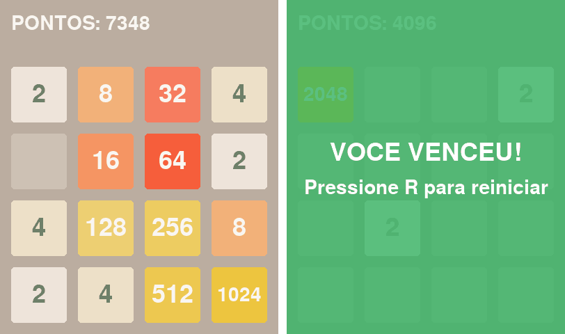

# Jogo 2048 em Python com Pygame

Versão completa do 2048 com interface gráfica, desenvolvida como projeto acadêmico no curso de Engenharia de Computação da PUCPR.



## Como jogar

- Use as **setas** ou **W A S D** para mover as peças.
- Peças iguais que se encostam se fundem e somam pontos.
- Chegue a uma peça de **2048** para vencer. Se o tabuleiro encher sem movimentos possíveis, é fim de jogo.
- Na tela final, aperte **R** para recomeçar.

## Destaques da implementação

- **Uma lógica de movimento para as quatro direções:** todo movimento é tratado como "para a esquerda". Para os outros sentidos, o tabuleiro é espelhado e/ou transposto antes, e a transformação é desfeita depois. Cada linha passa por *comprimir → fundir → comprimir*.
- **Estados com `Enum`:** a partida fica sempre em `JOGANDO`, `VITORIA` ou `DERROTA`, e o laço principal decide o que fazer a partir desse estado.
- **Nova peça só quando o tabuleiro muda:** um movimento que não altera nada não gera peça nova, como no jogo original.
- **Interface:** cor por valor de peça, placar e telas semitransparentes de vitória e de fim de jogo.

## Como executar

```bash
pip install -r requirements.txt
python jogo_2048.py
```

Para testar a vitória sem jogar uma partida inteira:

```bash
python teste_vitoria.py
```

Esse arquivo abre o jogo com quatro peças de 512. Aperte **←** e depois **↑** para chegar ao 2048.

## Estrutura

```
jogo_2048.py       jogo completo
teste_vitoria.py   abre o jogo com tabuleiro pré-carregado para testar a vitória
requirements.txt   dependência (pygame)
```

---

Frederico Assis Castellano · Engenharia de Computação, PUCPR
